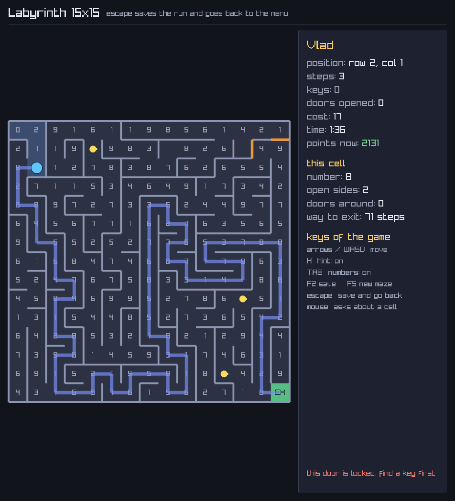

# aMAZEing

A maze game written in **C++23**. The player starts in the top left cell and
has to find the way out of the bottom right one. The maze is drawn with
**raylib**, and everything the game remembers — settings, best runs and saved
games — is stored locally in **JSON** with **nlohmann/json**.



## The team

| Name | Role | GitHub |
| --- | --- | --- |
| Vladimir Kosev | SCRUM Trainer | [vladosfluxi](https://github.com/vladosfluxi) |
| Simeon Kostin | Backend Developer | [SAKostin24](https://github.com/SAKostin24) |
| Juliana Stoykova | Backend Developer | [JYStoykova24](https://github.com/JYStoykova24) |
| Aleksei Spirin | QA | [AASpirin24](https://github.com/AASpirin24) |


## Presentation and documentation

| | |
| --- | --- |
| Presentation | [open the presentation](../docs/presentation) |
| Technical documentation | [open the documentation](../docs/technicalDocumentation) |

## What the game does

* The size of the maze is chosen by the player, from **10x10 up to 50x50**.
* A **new maze** is built every time a game is started.
* The whole maze is visible from above: the walls, the open ways and the exit.
* The player walks with the **arrow keys** (or W, A, S, D) and can never walk
  through a wall.
* **Doors** are special walls. A door is only placed where it makes the way to
  the exit clearly shorter, and it takes one **key** to open. The keys lie
  somewhere in the maze, and there is always one more key than there are doors.
* Every cell carries a **number from 1 to 9**. Walking on it adds that number
  to the cost of the run, so the shortest way is not always the cheapest one.
* A run can be **saved** and continued later, and finished runs go into a score
  board of the ten best results.

## Points

```
points = rows × columns × 10      the size of the maze
       + openedDoors × 50         for finding a key and using it well
       − steps × 2                a short way is better
       − collectedCost            cheap cells are better
       − seconds                  a fast run is better
```

The result never falls below zero.

## Controls

| Key | What it does |
| --- | --- |
| arrow keys / W A S D | walk one cell |
| H | show or hide the hint, the shortest way to the exit |
| TAB | show or hide the numbers of the cells |
| F2 | save the run |
| F5 | build a new maze with the same size |
| escape | save the run and go back to the menu |
| enter | choose the marked line of a menu |
| mouse | point at any cell to read its number and its open sides |

## The three layers

The project is split into three layers, and each one is its own build target.
A layer may only use the layers below it.

```
  app/              executable        window, drawing, keyboard      raylib
   |
   v
  libs/storage/     shared library    the JSON files                 nlohmann/json
   |
   v
  libs/core/        static library    the rules of the game          standard library only
```

* **libs/core** holds the rules. It never reads the keyboard, never draws and
  never opens a file — it only calculates. That is why all of it can be tested
  without a window.
* **libs/storage** turns a maze and a result into JSON and back. It is the only
  part of the project that touches the file system.
* **app** is the program the player starts. It owns the window, draws the maze
  and sends the pressed keys to the core library.

## Project structure

```
aMAZEing/
├── CMakeLists.txt              the three build steps
├── cmake/                      dependencies and warning settings
├── libs/
│   ├── core/                   layer 1, static library
│   │   ├── include/core/
│   │   └── src/
│   └── storage/                layer 2, shared library
│       ├── include/storage/
│       └── src/
├── app/                        layer 3, the executable
│   ├── include/app/
│   └── src/
├── tests/                      unit tests in the Visual Studio style
└── docs/                       the documentation
```

## Building

Needed: a C++23 compiler and CMake. **raylib** and **nlohmann/json** do not
have to be installed: CMake looks for them on the computer and downloads them
when they are missing, so the first configure step needs an internet
connection. Git is not needed either, because both arrive as a normal archive.

| System | Compiler | CMake |
| --- | --- | --- |
| Windows | Visual Studio 2022 (17.4+) or MinGW-w64 with GCC 13+ | 3.25 or newer |
| Linux | GCC 13+ or Clang 17+ | 3.21 or newer |
| macOS | Apple Clang 15+ or Clang 17+ | 3.21 or newer |

CMake always builds in the order of the layers: first the static library, then
the shared library, then the executable that links both of them together.

### Windows with Visual Studio 2022

Visual Studio needs the part **"Desktop development with C++"**, which brings
CMake with it.

**In Visual Studio:** `File > Open > Folder...` and choose the project folder.
Visual Studio reads `CMakeLists.txt` by itself. Pick the configuration
`x64-Release` in the toolbar, then `Build > Build All`, and start it with
`Ctrl+F5`.

**In the Developer PowerShell:**

```powershell
cmake -S . -B build -G "Visual Studio 17 2022" -A x64
cmake --build build --config Release
.\build\bin\Release\labyrinth.exe
```

Visual Studio can hold several kinds of build in one folder, so the files land
in `build\bin\Release\`.

### Windows with MinGW-w64 (MSYS2)

Use the **MSYS2 UCRT64** window, and install the tools once:

```bash
pacman -S --needed mingw-w64-ucrt-x86_64-gcc mingw-w64-ucrt-x86_64-cmake mingw-w64-ucrt-x86_64-ninja
```

```bash
cmake -S . -B build -G Ninja -DCMAKE_BUILD_TYPE=Release
cmake --build build
./build/bin/labyrinth.exe
```

### Linux and macOS

```bash
cmake -S . -B build -DCMAKE_BUILD_TYPE=Release
cmake --build build
./build/bin/labyrinth
```

On Linux the game needs the usual development packages of the desktop
(`libx11-dev`, `libxrandr-dev`, `libxinerama-dev`, `libxcursor-dev`,
`libxi-dev`, `libgl1-mesa-dev` on Debian or Ubuntu); raylib needs them to open
a window.

### Building and starting in one step

```bash
cmake --build build --target run
```

## Tests

33 automatic tests, written the way Visual Studio writes a native unit test
project, with `TEST_CLASS`, `TEST_METHOD` and `Assert`.

```bash
ctest --test-dir build --output-on-failure
```

With Visual Studio, say which build to test:

```powershell
ctest --test-dir build -C Release --output-on-failure
```

In Visual Studio itself the tests appear in the **Test Explorer**
(`Test > Run All Tests`). The two test programs can also be started directly,
and then they list every test method with its result:

```bash
./build/bin/coreTests
./build/bin/storageTests
```

## Where the game keeps its files

| System | Folder |
| --- | --- |
| Windows | `%APPDATA%\labyrinth` |
| macOS | `~/Library/Application Support/labyrinth` |
| Linux | `$XDG_DATA_HOME/labyrinth` or `~/.local/share/labyrinth` |

| File | Content |
| --- | --- |
| `settings.json` | name of the player, last maze size, hint on or off |
| `scores.json` | the ten best runs |
| `savedGame.json` | the run that was saved last |

The exact path is shown on the "how to play" screen inside the game, and the
environment variable `LABYRINTH_DATA_DIR` moves the folder somewhere else.
